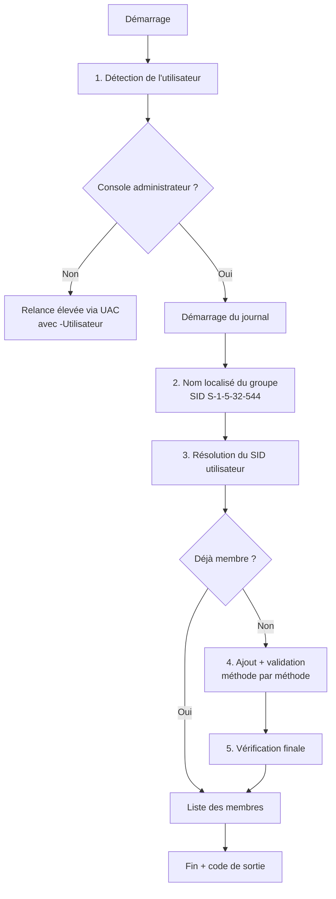

# Add-LocalAdmin

Script PowerShell **robuste** pour ajouter un utilisateur (de domaine ou local) au groupe **Administrateurs local** d'un poste Windows, avec **méthodes de repli** à chaque étape et **vérification systématique** du résultat.

Conçu pour le terrain : poste en français ou en anglais, contrôleur de domaine injoignable (VPN coupé, poste nomade), SID orphelins dans le groupe, console non élevée… le script essaie plusieurs approches avant d'abandonner, et le dit clairement.


---

## Sommaire

- [Fonctionnalités](#fonctionnalités)
- [Prérequis](#prérequis)
- [Utilisation](#utilisation)
- [Fonctionnement détaillé](#fonctionnement-détaillé)
- [Codes de sortie](#codes-de-sortie)
- [Journal](#journal)
- [Déploiement en masse](#déploiement-en-masse)
- [Dépannage](#dépannage)
- [Avertissement sécurité](#avertissement-sécurité)
- [Licence](#licence)

---

## Fonctionnalités

| Fonction | Détail |
|---|---|
| Détection automatique de l'utilisateur | Récupère l'utilisateur de la session interactive **avant** l'élévation UAC (sinon on obtiendrait le compte admin) |
| Élévation UAC automatique | Se relance en administrateur si nécessaire, en conservant l'utilisateur cible |
| Indépendant de la langue | Le groupe est identifié par son SID well-known `S-1-5-32-544` (`Administrateurs` / `Administrators` / …) |
| Hors ligne | Résolution du SID via le profil en cache si le contrôleur de domaine est injoignable |
| Tolérant aux SID orphelins | Vérification via ADSI par comparaison de SID (évite le bug connu de `Get-LocalGroupMember`) |
| Idempotent | Si l'utilisateur est déjà membre, rien n'est modifié |
| Vérification après ajout | Chaque méthode d'ajout est validée ; sinon la suivante est tentée |
| Journalisation | Transcript horodaté dans `C:\Windows\Temp` (repli `%TEMP%`) |
| Automatisable | Paramètre `-SansPause` et codes de sortie exploitables |

## Prérequis

- Windows 10 / 11 ou Windows Server 2016+
- Windows PowerShell **5.1** (compatible PowerShell 7)
- Droits administrateur local (ou identifiants admin à fournir lors de l'invite UAC)
- Pour un compte de domaine jamais connecté sur le poste : contrôleur de domaine joignable

> Le fichier doit rester encodé en **UTF-8 avec BOM**, sinon les accents s'affichent mal sous PowerShell 5.1.

## Utilisation

### Ajouter l'utilisateur actuellement connecté

```powershell
powershell -ExecutionPolicy Bypass -File .\Add-LocalAdmin.ps1
```

### Ajouter un utilisateur précis

```powershell
powershell -ExecutionPolicy Bypass -File .\Add-LocalAdmin.ps1 -Utilisateur "CONTOSO\jdupont"
```

### Exécution sans interaction (script, RMM, tâche planifiée)

```powershell
powershell -NoProfile -ExecutionPolicy Bypass -File .\Add-LocalAdmin.ps1 -Utilisateur "CONTOSO\jdupont" -SansPause
echo $LASTEXITCODE
```

### Paramètres

| Paramètre | Type | Description |
|---|---|---|
| `-Utilisateur` | `string` | Compte cible au format `DOMAINE\utilisateur`. Si omis : utilisateur de la session courante. |
| `-SansPause` | `switch` | N'attend pas « Entrée » en fin d'exécution. |

Après l'ajout, l'utilisateur doit **se déconnecter puis se reconnecter** pour que le jeton contienne le nouveau groupe. Contrôle :

```cmd
whoami /groups | findstr S-1-5-32-544
```

## Fonctionnement détaillé

Chaque étape essaie plusieurs méthodes dans l'ordre. Dès qu'une méthode renvoie un résultat valide, on passe à l'étape suivante.



| Étape | Méthode 1 | Méthode 2 | Méthode 3 | Méthode 4 |
|---|---|---|---|---|
| 1. Utilisateur | Propriétaire de `explorer.exe` de la session | `Win32_ComputerSystem.UserName` | `quser` | `%USERDOMAIN%\%USERNAME%` |
| 2. Nom du groupe | Traduction du SID `S-1-5-32-544` | `Win32_Group` | `Administrateurs` (défaut) | — |
| 3. SID utilisateur | Contrôleur de domaine (`NTAccount.Translate`) | Profil en cache (`HKLM\…\ProfileList`) | `Win32_UserAccount` | — |
| 4. Ajout | ADSI `WinNT://<SID>` | `Add-LocalGroupMember` | `net localgroup /add` | — |
| 5. Vérification | ADSI (comparaison de SID) | `Get-LocalGroupMember` | `net localgroup` | — |

L'ajout par **SID** (et non par nom) permet de fonctionner même lorsque le contrôleur de domaine n'est pas joignable, à condition que le SID ait pu être résolu depuis le profil en cache.

## Codes de sortie

| Code | Signification |
|---|---|
| `0` | Succès (ajouté et vérifié, ou déjà membre) |
| `1` | Échec (utilisateur introuvable, élévation refusée, toutes les méthodes en échec…) |
| `2` | Ajout effectué, mais aucune méthode de vérification n'a abouti |

## Journal

Un transcript est écrit à chaque exécution élevée :

```
C:\Windows\Temp\Add-LocalAdmin_AAAAMMJJ_HHMMSS.log
```

Repli sur `%TEMP%` si le dossier n'est pas accessible en écriture ; à défaut, l'exécution continue sans journal.

Exemple de sortie console :

```
[ESSAI ] Détection de l'utilisateur - méthode 1/4 : Propriétaire de explorer.exe (session courante)
[OK    ] Utilisateur cible : CONTOSO\jdupont
[INFO  ] Poste : PC-042 (domaine : contoso.local)
[ESSAI ] Nom du groupe - méthode 1/3 : Traduction du SID
[OK    ] Groupe : Administrateurs (S-1-5-32-544)
[ESSAI ] Résolution du SID - méthode 1/3 : Contrôleur de domaine (NTAccount)
[OK    ] SID : S-1-5-21-...-1104
[ESSAI ] Ajout au groupe - méthode 1/3 : ADSI (WinNT://SID)
[OK    ] VÉRIFICATION OK : CONTOSO\jdupont est membre de Administrateurs.
```

## Déploiement en masse

Sur plusieurs postes via PowerShell Remoting :

```powershell
$postes = 'PC-001','PC-002','PC-003'
Invoke-Command -ComputerName $postes -FilePath .\Add-LocalAdmin.ps1 -ArgumentList 'CONTOSO\jdupont', $true
```

> En exécution distante, il n'y a pas de session interactive : renseignez **toujours** `-Utilisateur`.
> Pour un parc géré, préférez une stratégie centralisée (GPO *Préférences > Utilisateurs et groupes locaux*, Intune *Account protection*, ou Windows LAPS pour le compte admin local).

## Dépannage

| Symptôme | Cause probable | Solution |
|---|---|---|
| Accents illisibles dans la console | Fichier enregistré sans BOM | Réenregistrer en **UTF-8 avec BOM** |
| « Impossible de résoudre le SID » | DC injoignable et aucun profil en cache | Connecter le poste au réseau / VPN, ou vérifier l'orthographe du compte |
| L'ajout disparaît après `gpupdate` | GPO *Groupes restreints* qui écrase le groupe | `gpresult /h C:\gpo.html` et corriger la GPO |
| Droits non appliqués | Jeton de session non rafraîchi | Déconnexion / reconnexion de l'utilisateur |
| `Get-LocalGroupMember` échoue | SID orphelins dans le groupe (bug connu PS 5.1) | Normal : le script utilise ADSI en priorité |
| Script bloqué au lancement | Politique d'exécution | Lancer avec `-ExecutionPolicy Bypass` ou `Unblock-File .\Add-LocalAdmin.ps1` |

## Avertissement sécurité

Accorder les droits administrateur local étend considérablement la surface d'attaque d'un poste (installation de logiciels, désactivation de l'antivirus, extraction d'identifiants, mouvement latéral). Recommandations :

- appliquer le **principe du moindre privilège** et limiter ces droits dans le temps ;
- tracer chaque ajout (le journal fourni par le script peut servir de preuve) ;
- auditer régulièrement le groupe (événement **4732** — *membre ajouté à un groupe local de sécurité*) ;
- n'utiliser ce script que sur des systèmes dont vous avez la responsabilité ou une autorisation explicite.

## Licence

Distribué sous licence [MIT](LICENSE).

## Auteur

**Pietro Milioto** — IT System & Cybersecurity Specialist (freelance)
GitHub : [@jfetx](https://github.com/jfetx)
